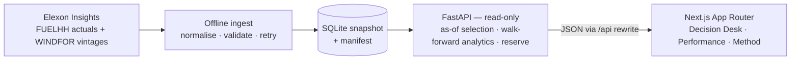

# REint — GB wind decision desk

A full-stack replay of the UK wind forecast that was actually available before
day-ahead gate closure. For any January 2026 delivery day, the app shows the latest
Elexon wind vintage published at or before **09:20 D-1**, compares it with realised
wind, and sizes a walk-forward reserve margin from measured forecast error.

The product never uses a forecast that did not exist at decision time.

**Live demo:** <https://reint-web.vercel.app> ·
[15 January, 09:20 D-1, 90%](https://reint-web.vercel.app/?date=2026-01-15&gate=09:20&confidence=0.9) ·
[API docs](https://reint-api.vercel.app/api/docs)

- **Decision desk** — selected forecast, realised actuals, walk-forward residual band,
  reserve in GW and GWh, hourly detail, and an audit trail for every delivery hour.
- **Performance** — MAE, RMSE, bias, persistence skill, band coverage, daily results,
  and error by realised lead time and wind level.
- **Method** — the data, the as-of rule, the hourly grid, the calibration method, and
  the limitations.

The deeper architecture and decision record is in [`docs/design.md`](docs/design.md).
Presentation notes, the demo script, and Q&A prep are in
[`docs/video-guide.md`](docs/video-guide.md). If the metrics are unfamiliar, start with
[`docs/metrics-explained.md`](docs/metrics-explained.md). A jargon-light narration is
in [`docs/video-script-plain-english.md`](docs/video-script-plain-english.md).

## Quick start

Prerequisites: Python 3.12+, [`uv`](https://docs.astral.sh/uv/), Node.js 20.9+, and
npm. The committed snapshot means no network access is needed to run the app.

```bash
make install
make run
```

Open <http://localhost:3000>. The API runs on <http://localhost:8000> and its docs are
at <http://localhost:8000/api/docs>.

The Next.js app proxies `/api/*` to `BACKEND_ORIGIN` (default
`http://localhost:8000`), so the browser sees one origin and there is no CORS in the
normal path.

### Rebuild the snapshot

The January 2026 snapshot is committed at `backend/data/snapshot.sqlite` with a
manifest beside it. To fetch a fresh month from Elexon:

```bash
make ingest MONTH=2026-01
```

This is the only command that touches the network. It calls `FUELHH` in seven-day
chunks for actuals, then the `WINDFOR` evolution endpoint once per delivery hour to
capture every vintage. Re-running is idempotent.

### Checks

```bash
make test     # backend pytest suite
make lint     # ruff, ty, eslint
make build    # Python type check, Next.js production build
```

## What the data actually is

Verified against the public Elexon Insights Solution, not assumed from the brief:

| Source | Shape | Notes |
| --- | --- | --- |
| `FUELHH`, `fuelType=WIND` | Half-hourly actuals | 48 rows/day; historical query uses `settlementDateFrom`/`settlementDateTo`, max 7 days per request |
| `WINDFOR` evolution | Hourly forecasts | One call per delivery hour returns all vintages; the plain dataset endpoint returns only the latest |
| Forecast publication | Irregular, ~8/day | Observed near 02:30, 04:30, 07:30, 09:30, 11:30, 15:30, 18:30, 22:30 UTC |

The committed snapshot covers **1–31 January 2026**, with 31 December 2025 actuals
for the persistence baseline:

- 1,536 half-hour actual rows
- 18,104 forecast vintages
- 744 delivery hours, no missing forecast hours
- one SQLite file, about 3.2 MB

### Measured results, 09:20 D-1

| Metric | Value |
| --- | ---: |
| Hourly forecast points | 744 |
| MAE | 2.14 GW |
| RMSE | 2.61 GW |
| Bias (actual − forecast) | −1.85 GW |
| 90% band coverage | 76.7% |
| Persistence MAE | 3.96 GW |
| Skill vs persistence | 46% |

The 15 January default view selects the 2026-01-14 07:30Z vintage and carries a peak
reserve of 6.35 GW. Coverage below the nominal 90% is real and is shown on the
Performance page rather than smoothed away.

## The decisions that matter

**Latest vintage before gate closure.** For each delivery hour, select the forecast
with the greatest `publish_time` that is still `<= decision_time`. At the default
09:20 gate this is usually the 07:30 vintage. The 09:30 vintage did not exist yet and
is excluded. The audit table shows the exclusion count for every hour.

**Hourly accuracy grid.** Actuals are half-hourly and forecasts are hourly. Accuracy
and reserve use hourly means of the actuals. Interpolating a forecast to half-hours
would invent intra-hour structure the source does not contain.

**Walk-forward empirical bands.** Each day's band uses only residuals from earlier
days, grouped by realised lead-time bucket. At 90% coverage the interval is the 5th
to 95th percentile; at 95% it is the 2.5th to 97.5th. The first seven days are
provisional; a bucket with fewer than five samples falls back to pooled residuals.
The band is asymmetric because forecast error is asymmetric.

**Reserve is the band's lower edge, not a total purchase.** At 90% coverage the
band is the 5th–95th percentile of prior residuals, so reserve is
`max(0, −Q5(actual − forecast))`; at 95% it is the 2.5th percentile. It is the
wind-cover margin the buyer combines with their own demand view. The brief supplies
no demand data, so inventing a total procurement quantity would be dishonest.

**Persistence baseline.** The comparison is the same hour on the previous day. The
performance page reports model MAE, persistence MAE, and
`skill = 1 − model_MAE / persistence_MAE`.

## Architecture



If the diagram does not render, the data flow is:
**Elexon → offline ingest → SQLite snapshot → FastAPI → Next.js → browser.**

- `backend/src/reint/providers/elexon.py` — the only module that knows Elexon shapes.
- `backend/src/reint/store/` — snapshot writer/reader and SQLite schema.
- `backend/src/reint/domain/` — selection, time grid, metrics, models.
- `backend/src/reint/services/analytics.py` — daily, accuracy, calibration views.
- `backend/src/reint/api/` — FastAPI app and routes.
- `frontend/app/` — Decision desk, Performance, Method.
- `frontend/components/charts/` — hand-built responsive SVG charts, no chart library.

## API

| Method | Path | Purpose |
| --- | --- | --- |
| GET | `/api/health` | Liveness + snapshot build time |
| GET | `/api/meta` | Snapshot coverage, gates, defaults |
| GET | `/api/days` | Delivery days and coverage |
| GET | `/api/day/{date}` | Selected forecast, actuals, band, reserve, provenance |
| GET | `/api/day/{date}/vintages` | Every vintage per hour and the selected one |
| GET | `/api/accuracy` | Metrics, baseline, daily and bucketed error |
| GET | `/api/calibration` | Walk-forward calibration history |

`date` is `YYYY-MM-DD`. `gate` is `09:20` or `15:30`. `confidence` is `0.9` or
`0.95`. The OpenAPI docs are served at `/api/docs`.

## Deploy

### Docker Compose (self-host)

Only the web service is exposed; the API stays on the internal network.

```bash
docker compose up --build
```

Open <http://localhost:3000>. Change the host port with `WEB_PORT=8080`. The API
snapshot is baked into the image, so there is no volume or database to operate.

### Vercel (two projects)

Deployed production URLs:

- **Web:** <https://reint-web.vercel.app>
- **API:** <https://reint-api.vercel.app>
- **API docs:** <https://reint-api.vercel.app/api/docs>

The frontend proxies `/api/*` at build time, so deploy the API first and then set the
frontend's `BACKEND_ORIGIN`.

1. **API project** — root directory `backend/`, framework preset **FastAPI** (or
   `@vercel/python` via `vercel.json`). The config includes `api/index.py`, `src/**`,
   and `data/**`. The deployed function serves the 3.2 MB snapshot from `data/`.
2. **Web project** — root directory `frontend/`, framework preset **Next.js**. Set
   `BACKEND_ORIGIN=https://reint-api.vercel.app` in the build environment.
3. Redeploy the web project after the API URL is known. The rewrite is baked at build
   time, so changing `BACKEND_ORIGIN` requires a new frontend build.

The API is read-only and cold-start friendly. It never writes to the filesystem at
request time.

## Known limitations

- **Metering scope.** `FUELHH` wind and `WINDFOR` GB wind may not cover the same
  population. The observed negative bias could be forecast error, scope mismatch, or
  both. No silent bias correction is applied.
- **One month.** January 2026 is the entire sample. Early-month bands are weaker
  evidence and are labelled provisional.
- **No demand, prices, or P&L.** The brief supplies only wind actuals and forecasts, so
  absolute thermal procurement and trading value are out of scope.
- **Actual revisions.** The snapshot stores the latest published actual for each
  settlement period, not every revision.
- **Vercel snapshot bundling.** Verified on the deployed API; the function serves the
  committed snapshot and returns the expected 744-hour coverage.

## Repository layout

```
backend/            FastAPI, ingest, SQLite snapshot, tests
frontend/           Next.js 16 App Router, Tailwind v4, SWR, SVG charts
docs/design.md      Architecture and decision record
docker-compose.yml  API + web, one exposed port
Makefile            install, ingest, run, test, lint, build, docker
```

## Author

Built as a full-stack take-home for gridbricks, October 2026. Data: Elexon Insights
Solution. The snapshot and the code are the reproducible artefact; the public demo is
the reviewer's shortcut.

## AI tool disclosure

This project was built with AI assistance. Harness: OpenCode (opencode). Models: free-tier / open-weight models (e.g., openrouter/thinkingmachines/inkling-small:free). All code, design, and documentation were reviewed and verified by the author before submission.
