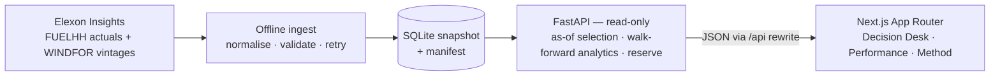

# Design — Wind Forecast Decision Desk

## Purpose

This is the architecture for a take-home product for a UK energy utility's day-ahead
power-buying team. It proposes what to build, the decisions behind it, and what is
deliberately left out. The reader is the person who will implement it and the
technical lead who will review it.

## Why

The buyer must commit to day-ahead purchases before knowing how much wind will
actually blow. They need two things: the wind forecast that was genuinely available
at the moment they had to decide, and a quantified sense of how wrong that forecast
tends to be, so they can buy a defensible amount of non-wind cover.

Success looks like this: for any decision date in January 2026, the user sees the
vintage of the Elexon wind forecast that was the latest one published before gate
closure, sees it against realised wind, and sees a reserve margin derived from
measured forecast error. The product never uses a forecast that did not exist yet.

The challenge supplies only wind actuals and wind forecasts. Demand is not in scope,
so the product cannot say "buy 4.2 GW of thermal" in absolute terms. It can say
"if your plan assumes the forecast wind, carry this much extra cover at 90%
confidence", which is the useful half of the calculation the buyer can combine with
their own demand view.

## What the data actually is

Verified against the live Elexon Insights API on 25 October 2026, not assumed from
the brief:

- No API key is needed.
- `FUELHH` actuals are half-hourly. Historical queries work through
  `settlementDateFrom` / `settlementDateTo`, not `from` / `to`, and the maximum range
  is 7 days per request. `fuelType=WIND` returns 48 rows per day.
- `WINDFOR` forecasts are hourly, not half-hourly. The `/datasets/WINDFOR` endpoint
  returns only the latest published vintage. The full history for one delivery hour
  is available from `/forecast/generation/wind/evolution?startTime=...`, which
  returns every vintage for that hour.
- Forecasts are published irregularly, roughly eight times a day (observed at 02:30,
  04:30, 07:30, 09:30, 11:30, 15:30, 18:30, 22:30 UTC), not on a clean schedule.
- A one-month snapshot needs about 1,488 evolution calls (one per delivery hour).
  Measured at concurrency 8, that is roughly three minutes.
- The full January 2026 snapshot has 1,536 half-hour actual rows, 18,104 forecast
  vintages, 744 delivery hours, and no missing forecast hours. At the default 09:20
  gate, hourly MAE is about 2.14 GW, RMSE 2.61 GW, bias (actual − forecast) −1.85 GW,
  and measured 90% band coverage 76.7%. Persistence (same hour previous day) has MAE
  about 3.96 GW, so the forecast skill score is about 46%. The bands under-cover the
  nominal 90%; that is reported rather than hidden.

Two consequences follow. First, the snapshot must store every vintage, not just the
latest, or the "what was available at decision time" question cannot be answered.
Second, forecast and actual are on different time grids, so the comparison grid is a
design decision, not an implementation detail.

## Shape

One Python service owns ingestion, replay, analytics, and the API. One Next.js
app consumes it. A committed snapshot makes both deterministic.

Data flow: **Elexon → offline ingest → SQLite snapshot → FastAPI → Next.js →
browser.** The API never calls Elexon at request time; the browser never sees a
second origin.

The modules:

- **Elexon adapter** — speaks to the two Elexon endpoints and normalises their
  payloads into domain records.
  - exposes: `fetch_actuals(from_date, to_date)`, `fetch_vintages(delivery_hour)`.
  - hands off: validated records to the snapshot writer. No other module knows the
    Elexon URL shapes.
- **Snapshot writer / store** — builds and reads the historical dataset.
  - exposes: `build_snapshot(month, client, path)`, `read_snapshot(path)`, and the
    manifest beside the snapshot.
  - hands off: SQLite rows to the replay and analytics modules; a manifest to the API.
- **Replay / selection engine** — given a delivery period and a decision rule,
  returns the forecast vintage that was in force.
  - exposes: `select_forecast(vintages, decision_time)`, `build_hour_points(...)`, and
    `GateRule.decision_time(delivery_hour)`.
  - hands off: selected forecasts and residuals to analytics and the API.
- **Analytics engine** — computes accuracy, baselines, calibration, and the reserve
  margin, with a strict as-of boundary.
  - exposes: `accuracy_view(range, gate, confidence)`, `daily_view(date, gate, confidence)`,
    `calibration_view(range, gate, confidence)`, and `vintages_view(date, gate)`.
  - hands off: JSON-serialisable result objects to the API.
- **HTTP API** — read-only contract for the frontend.
  - exposes: `/api/meta`, `/api/days`, `/api/day/{date}`, `/api/day/{date}/vintages`,
    `/api/accuracy`, `/api/calibration`, `/api/health`, plus `/api/docs`.
  - hands off: JSON to the Next.js app.
- **Web app** — three surfaces: Decision Desk, Forecast Performance, and Method.
  - exposes: nothing programmatic; it is the user surface.
  - hands off: nothing; it only calls the API.
- **Ops contract** — Makefile, two Dockerfiles, compose file, `vercel.json`, README.
  - exposes: `make install`, `make ingest`, `make run`, `make test`, `make lint`,
    `make build`, `make docker-up`.
  - hands off: a reproducible environment to a reviewer.

Data flow: Elexon → adapter → snapshot (SQLite + manifest) → selection engine →
analytics → API → Next.js. Ingestion is an explicit offline command. Serving is
read-only, so a demo never depends on Elexon being up.

## State

- The snapshot SQLite file is the only durable state. It lives in `backend/data/`, is built
  by `make ingest`, and is committed (or built in the Docker image) so the deployed
  app is deterministic.
- A manifest records source, fetch time, row counts, date coverage, and known gaps.
- The API holds no per-user state. Filters are UI state; shareable URLs are a
  stretch goal, not a v1 requirement.
- Secrets: none today, because Elexon is public. If a key is added later it lives in
  an environment variable and never in the snapshot.

## Operating it

- **Who runs it** — the reviewer runs one command; the deployed instance needs no
  operator. There are no users to add or remove.
- **Update** — new months are added by `make ingest MONTH=...`, which rewrites the
  snapshot and manifest; re-running is idempotent.
- **Version** — `/api/health` reports the build version injected at build time and
  the snapshot build time, not a hand-typed number.
- **Deploy from nothing** — two supported targets from one codebase. Vercel: the
  Next.js app and the FastAPI app deploy as two projects; the Next.js project proxies
  `/api/*` to the API project, so the browser sees one origin. Docker: Compose runs
  the Next.js app and the API as two services, with the same proxy rule; only the web
  service is exposed, and it runs on the user's server behind their existing proxy.
- **Move** — the two Vercel projects or the Compose stack plus the snapshot is the
  whole system; no external database or volume is required.
- **Help** — `make help` lists every target; the README covers run and deploy.
- **Bugs** — issues go to the public repo; for a take-home, the README names the
  author and the repo's issue tracker.
- **Failure** — if the snapshot is missing, the API fails loudly with a clear message
  and the UI shows "snapshot not built" rather than empty charts. If the host is
  cold, the UI shows a loading state; no data is fetched from Elexon at request time.

## Scenarios

**A buyer replays 15 January 2026.** They open Decision Desk, pick 15 January, and
leave the default gate closure at 09:20 D-1. The API asks the selection engine for
the latest vintage per delivery hour with `publish_time <= 2026-01-14T09:20Z`; that
is the 07:30 vintage, because the 09:30 one did not exist at decision time. The page
shows the forecast curve, the realised actuals behind it, the walk-forward residual
band,
and a reserve figure of the band's lower edge. A provenance panel names the exact
publish times used. No actual from January appears in the selection path.

**The technical lead checks the numbers.** They open Forecast Performance, choose the
month, and see MAE, RMSE, bias, band coverage, and a persistence
baseline. They click a day and see the residuals that produced the aggregates. The
report labels whether rows are in-sample or out-of-sample; bands are calibrated only
on days before the day being shown.

**A developer adds a second fuel or source.** They implement the adapter contract
with the new source, register it by name, and rebuild the snapshot. Selection,
analytics, API, and UI do not change as long as the adapter emits the same domain
records. If the new source is half-hourly, it declares its native resolution and the
analytics continue to work on the declared grid.

## Decisions

### Historical replay from a snapshot, not live calls

- **Options:** A — call Elexon live per page view (simplest, always "latest", but
  slow, rate-limited, non-deterministic, and cannot answer "what was available
  then"). B — precompute a committed snapshot and serve from it (deterministic,
  fast, demo-safe, needs a refresh command). C — hybrid: snapshot for replay plus a
  live panel.
- **Chose:** B for v1, with the adapter and `make ingest` in place so C is a small
  addition.
- **Consequences:** The demo is reproducible and works offline. The snapshot must be
  rebuilt to include new data, and a stale snapshot is visible in the manifest.
  Live "today" views are deferred.

### Gate closure at 09:20 D-1

- **Options:** A — fixed noon D-1 (easy, arbitrary). B — 09:20 D-1, the EPEX GB
  hourly day-ahead auction gate closure (defensible; matches one real decision
  point). C — 15:30 D-1 for the GB half-hourly auction, or user-selectable.
- **Chose:** B as the default, with the rule as a parameter and 15:30 selectable.
  The UI states the rule in words next to the timestamp.
- **Consequences:** The selected vintage is usually the 07:30 publication, not the
  09:30 one; that gap is a feature to show, not a bug to hide. The product speaks to
  one real market timing. Different buyers use different auctions, so the rule must
  remain configurable.

### Latest vintage before decision time

- **Options:** A — latest forecast overall (simple, introduces look-ahead bias).
  B — forecast published exactly N hours before delivery (clean lead time, but may
  not correspond to a real publication). C — latest vintage with
  `publish_time <= decision_time` (mirrors what a buyer could actually see).
- **Chose:** C.
- **Consequences:** Lead time varies with publication cadence and delivery hour. The
  analytics must bucket by realised lead time, not assume a fixed horizon. Every
  reported number has a provenance trail.

### Accuracy on an hourly grid

- **Options:** A — compare half-hourly actuals to the hourly forecast by repeating
  the hour (simple, fabricates precision). B — aggregate actuals to hourly means and
  evaluate there (honest, loses half-hour detail). C — interpolate the forecast to
  half-hourly and evaluate at settlement-period level (matches market granularity,
  invents intra-hour structure).
- **Chose:** B for all accuracy metrics, reserve sizing, and the charts. The UI
  evaluates and draws hourly means; it does not imply intra-hour precision.
- **Consequences:** The headline numbers are defensible. Intra-hour forecast error
  is not measured. If a half-hourly forecast source is added, the analytics grid
  becomes a declared property of the source.

### Empirical residual bands, walk-forward

- **Options:** A — one normal distribution for all errors (simple, ignores skew and
  horizon). B — empirical P5/P95 by lead-time bucket, calibrated on days before the
  evaluated day (interpretable, captures skew, needs enough history). C — train a
  model (overkill for one month and hard to defend).
- **Chose:** B, with a minimum burn-in of seven days and a fallback to pooled
  early-month bands labelled as such.
- **Consequences:** The band is asymmetric, which matters for procurement. Early
  January is weaker evidence than late January and must say so. The method is
  explainable to a reviewer without a statistics lecture.

### Reserve = lower-edge shortfall

- **Options:** A — show only MAE (easy, not actionable for cover). B — show
  forecast ± MAE (symmetric, not a confidence statement). C — reserve =
  max(0, −Q5(actual − forecast)) for the relevant horizon, i.e. the lower edge of the
  90% central band, the shortfall the forecast missed in about 5% of comparable cases.
- **Chose:** C, with a 90% / 95% toggle.
- **Consequences:** The buyer gets a number they can act on and the assumption is
  explicit. At 95% coverage the band and reserve move to the 2.5th percentile. The
  number is only as good as the historical sample and is not a guarantee. It is a
  wind-cover margin, not a total procurement quantity.

### SQLite snapshot

- **Options:** A — JSON files (simple, no query layer, awkward for joins). B — SQLite
  (single file, SQL joins, trivial to ship and query). C — Postgres (operationally
  heavy for a one-month read-only dataset).
- **Chose:** B.
- **Consequences:** The image is self-contained and queries are easy. Writing is
  single-writer, which is fine for a batch ingest. A move to Postgres later changes
  the store module only.

### Vercel primary, Docker Compose self-host

- **Options:** A — single Docker image only (one origin, simplest, but needs a paid
  host or the user's server for a public link). B — Vercel frontend plus a separately
  addressed API (two public origins and CORS). C — Vercel frontend plus a FastAPI
  project, with the frontend proxying `/api/*` to the API, and the same two-service
  shape in Docker Compose for self-hosting.
- **Chose:** C. Vercel is the link that goes in the submission; Docker Compose is the
  reproducible self-host and the reviewer's local path.
- **Consequences:** The browser sees one origin in both targets, so no CORS and no
  exposed API URL in the UI. The API must stay a pure ASGI app with no writable
  filesystem at request time; it reads the bundled snapshot and never calls Elexon.
  Vercel needs an explicit entrypoint and an include rule for the SQLite snapshot.
  The frontend's API base stays relative (`/api`), with a Next.js rewrite to
  `BACKEND_ORIGIN` for local dev and self-host. Vercel Services could collapse the
  two projects into one, but it is still beta, so the stable two-project shape wins.

### Next.js App Router, three surfaces

- **Options:** A — one long dashboard (fast to build, weak narrative). B — Decision
  Desk and Forecast Performance as separate views, plus a Method page (clearer
  story, slightly more routing). C — multi-page app with auth (unnecessary).
- **Chose:** B, on the user's existing Next.js 16 App Router scaffold with Cache
  Components enabled.
- **Consequences:** The customer pitch has an obvious path: decide, then check the
  evidence. The reviewer can jump straight to methodology. Data is fetched on the
  client from `/api`, so the build never depends on the API being up and Next.js
  caching does not sit between the dashboard and the snapshot. No auth, no user
  state, no admin surface.

## Not doing

- **Demand forecasting and absolute procurement quantities** — no demand data is in
  scope, so inventing it would undermine the analysis. The product delivers the wind
  side and its uncertainty.
- **Other fuels, interconnectors, embedded wind estimation** — the brief explicitly
  limits the data to Elexon wind actuals and forecasts.
- **Market prices, auction results, bids, and P&L** — not part of the two stated
  jobs, and would add data sources the brief excludes.
- **A trained ML forecasting model** — the product evaluates the supplied forecasts;
  it does not compete with them in v1.
- **Live streaming and scheduled refresh** — the historical replay is the product.
  The adapter leaves a clean seam for a live mode.
- **User accounts, roles, saved views** — no user state is required; URL filters are
  enough.
- **A server database, message queue, or background worker** — one batch ingest and
  one read-only process cover the need.
- **Mobile-first design** — the buyer works at a desk. The layout is responsive
  down to small screens, but the information hierarchy is designed for a wide desk
  view, not a phone.

## Open questions

- **Metering scope:** `FUELHH` wind may not cover the same population as `WINDFOR`
  GB wind. The observed −1.08 GW bias could be forecast error, scope mismatch, or
  both. The UI must state the caveat; v1 should not silently bias-correct.
- **Backend proxy origin:** the Next.js rewrite to `BACKEND_ORIGIN` is build-time
  configuration, so the Docker image is built per environment. If that becomes
  annoying, a runtime route handler can replace the rewrite without changing the
  API contract.
- **Actual revisions:** `FUELHH` returns the latest published actual for a period.
  The snapshot stores a fetch time; whether to preserve earlier vintages of actuals
  is unsettled and probably unnecessary for a pilot.
- **Early-month calibration:** seven days of burn-in leaves the first week with weak
  bands. The UI labels those days provisional, and the decision desk opens on 15
  January by default so the first impression is a calibrated day.
- **Half-hourly procurement:** the buyer purchases half-hourly, but the source
  forecast is hourly. The app stays on the hourly grid and labels the reserve as an
  hourly margin; it does not interpolate across settlement periods.
- **Deployment cold starts:** free tiers may sleep. The demo video should be recorded
  against a warm instance, and the README should note the first-load delay.

## Status

Built, verified locally, and deployed:

1. Ingest writes the January 2026 snapshot and manifest; the snapshot is committed.
2. Selection is covered by tests, including the no-look-ahead boundary.
3. API serves the decision desk, vintage audit, accuracy, and calibration views.
4. Web app builds and renders all three surfaces against the API.
5. Docker Compose builds and serves the stack on one exposed port.
6. The Vercel backend bundles the 3.2 MB snapshot and serves the full 744-hour
   coverage; the frontend proxies `/api/*` to it.
   - Web: <https://reint-web.vercel.app>
   - API: <https://reint-api.vercel.app>

Still to do before submission:

1. Record a short walkthrough against a warm instance.
